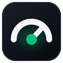

  

**Uniano Dev** is a product and development studio. We design, build and ship our own software to real stores and marketplaces, and we build client projects to the same standard.

### Our products

 **Uniano** — CS2 skin marketplace with zero commission  
[uniano.com](https://uniano.com) · live

 **Uniano Bridge** — Chrome extension that connects sellers' Steam inventory to Uniano  
[Chrome Web Store](https://chromewebstore.google.com/detail/uniano-bridge/laminlfhiikehdfamagkpahoknmjmgcj) · live

 **Signal Buffer Trader** — MetaTrader 5 Expert Advisor that trades any indicator's signals by your rules  
[MQL5 Market](https://www.mql5.com/en/market/product/205987) · live

 **Signal Buffer Inspector** — Free MetaTrader 5 utility that finds the indicator buffer behind a signal  
[MQL5 Market](https://www.mql5.com/en/market/product/205982) · live

 **Prop Account Guard** — cTrader cBot that keeps a prop-firm account inside its loss limits  
[cTrader Store](https://ctrader.com/products/6343) · live

 **Price & Stock Monitor** — Apify Actor that tracks prices and stock in WooCommerce and Shopify stores  
[Apify Store](https://apify.com/uniano/woocommerce-shopify-price-stock-monitor) · live

 **Hookvigil** — WooCommerce plugin that alerts when a webhook is disabled and lists missed orders  
[Source on GitHub](https://github.com/Uniano-Dev/hookvigil-for-woocommerce) · in WordPress plugin directory review

 **Driftcheck** — Shopify app that catches supplier stock and price drift before you oversell  
In Shopify App Store review

### What we build for clients

- **Trading tools** — MetaTrader 4/5 Expert Advisors and indicators, cTrader cBots, prop-firm risk guards
- **E-commerce** — WordPress and WooCommerce plugins, Shopify apps, store integrations
- **Web apps** — JavaScript and TypeScript, Node.js, React and Next.js, PostgreSQL, REST APIs
- **Automation** — API integrations, webhooks, n8n, Apify, Telegram bots
- **QA** — functional, regression and API testing, release checks

### How we work

- A written scope, acceptance criteria and a fixed price for the first stage before any code
- Every delivery comes with source code, short instructions and a test report: what was checked and what could not be verified
- Products and client work are held to the same bar: clean interface, careful defaults, tested before release

  <a href="https://uniano.dev"><b>uniano.dev</b></a> — studio site, products and how to start a project

